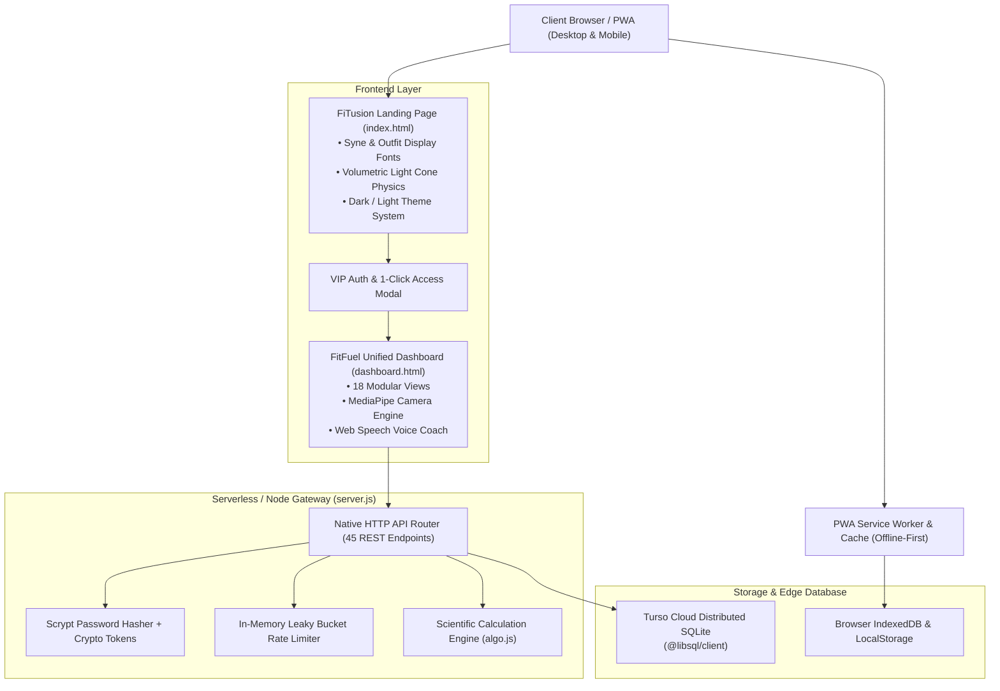
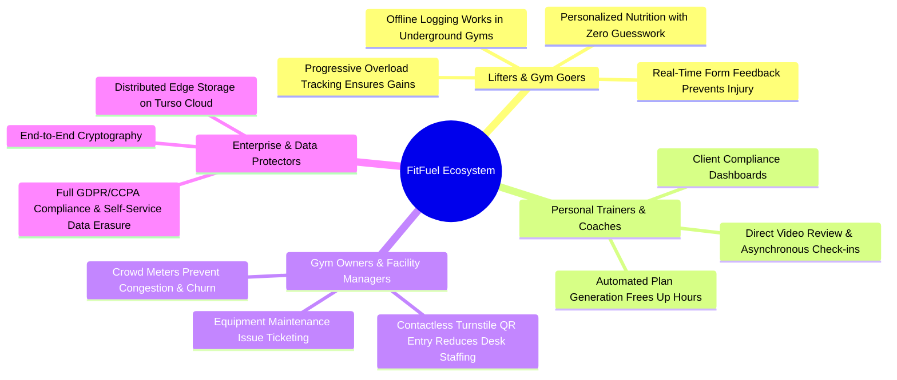
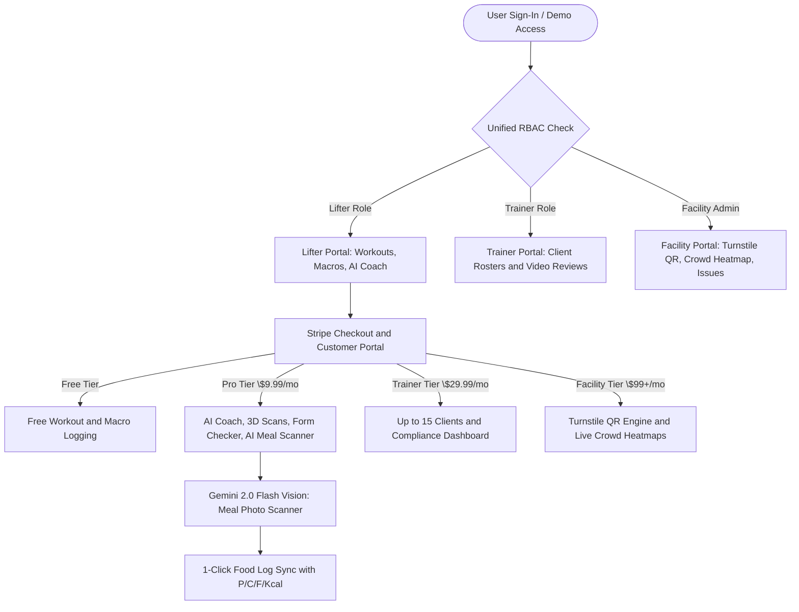

# FitFuel & FiTusion — Comprehensive Technical & Functional Specification

> **Version:** 2.0.0 Production  
> **Database:** Turso Cloud SQLite (Persistent & Edge Distributed)  
> **Backend:** Node.js Native HTTP Gateway (`server.js`)  
> **Frontend:** Standalone Cinematic FiTusion Landing (`index.html`) + Full Athletic Health Dashboard (`dashboard.html`)  
> **Offline Engine:** Service Worker PWA (`sw.js`) + IndexedDB Local Fallback  

---

## 1. Executive Summary & Value Proposition

**FitFuel** (operating under the front-facing brand **FiTusion**) is an all-in-one athletic intelligence, nutrition, and strength performance platform. Modern fitness software is typically fragmented: users need MyFitnessPal for calories, Strong or Hevy for weightlifting logs, a separate gym membership app for turnstile QR entry, another app for scheduling classes, and expensive personal trainers for form checks.

FitFuel unifies all of these capabilities into a single, high-performance, offline-capable progressive web application:
1. **Scientific Nutrition & Energy Balance:** Calibrated with the Mifflin-St Jeor equation, TDEE activity multipliers, dynamic macronutrient splits, and instant barcode scanning.
2. **Intelligent Strength Progression:** Safe starting load estimation algorithms, Rate of Perceived Exertion (RPE) auto-recalibration, and real-time exercise tracking.
3. **Computer Vision & Anthropometrics:** Local device MediaPipe pose estimation for live joint alignment/posture auditing and Ramanujan elliptical 3D body composition estimation.
4. **Facility & Community Operations:** Contactless turnstile QR entry codes, class reservation calendars, live gym floor traffic meters, and coach 1-on-1 direct channels.
5. **Privacy & Modern Architecture:** Zero tracking bloat, full GDPR/CCPA data export/erasure, and distributed edge sync via Turso SQLite.

---

## 2. System Architecture & Tech Stack



- **Frontend Tech:** Pure Vanilla ES6+, CSS3 Custom Properties with hardware-accelerated transforms, HTML5 Canvas, MediaPipe Pose, Web Speech Synthesis & Recognition, Web Audio API, SVG Iconography.
- **Backend Tech:** Node.js HTTP server, `@libsql/client/web` (Turso SQLite), Web Streams, native Node `crypto`.
- **Hosting & Deployability:** Vercel edge/serverless ready, Cloudflare Workers compatible, Docker containerizable.

---

## 3. Detailed Breakdown of Every Function & Module

### Module 1: FiTusion Cinematic Landing Experience (`index.html`)
- **Volumetric White Light Cone:** Positioned behind the athlete cutout, this element blooms on load and tracks mouse coordinates via a 60fps `requestAnimationFrame` lerp loop (`--cone-x`, `--cone-y`, `--tilt-x`, `--tilt-y`).
- **Brand Typography:** Built with `Syne` (high-fashion editorial geometric headers) and `Outfit` (clean neo-grotesque body copy).
- **Exact Crop Asset Integration:** Features authentic athlete cutouts, social proof badges ("12k+ Happy Spirits"), verified sponsor marques (Under Armour, Reebok, Adidas, Puma, The North Face, Nike), and course photography.
- **Dual Theme Switcher:** Instant toggle between Dark Mode (`#060709` pitch black with `#CEFF1A` neon lime) and Light Mode (crisp slate `#F8FAFC` porcelain with emerald accents).

### Module 2: VIP Authentication & Access Gate (`authModal`)
- **Crypto-Secured Auth:** Passwords hashed with Node `crypto.scryptSync` with unique salt per user; 64-character bearer tokens stored in HTTP-safe headers or secure cookies.
- **Rate-Limited Login Pipeline:** Protects against brute-force attacks by restricting authentication attempts per IP window.
- **Instant Demo Lifter Bypass:** Allows reviewers and investors to launch the full athlete profile with one click without entering credentials.

### Module 3: Daily Health & Command Center (`#view-today`)
- **Live Macro Ring Gauges:** Visual donut charts showing real-time Calories consumed vs. daily target, Protein (g), Carbohydrates (g), and Fat (g).
- **Hydration Tracker:** 1-tap quick-add logging for water intake (+250ml, +500ml, +750ml) with an animated water wave progress level.
- **Today's Workout Preview:** Shows the scheduled training split for the day (e.g. "Push A: Chest, Delts & Triceps") with expected duration and exercise count.
- **Daily Streak & Adherence:** Visual heat calendar tracking training frequency and nutrition logging consistency.

### Module 4: Scientific Calorie & Macronutrient Engine (`algo.js`)
- **Mifflin-St Jeor BMR Equation:**
  $$\text{BMR}_{\text{men}} = 10 \times \text{weight (kg)} + 6.25 \times \text{height (cm)} - 5 \times \text{age} + 5$$
  $$\text{BMR}_{\text{women}} = 10 \times \text{weight (kg)} + 6.25 \times \text{height (cm)} - 5 \times \text{age} - 161$$
- **TDEE Multipliers:** Sedentary ($1.2$), Lightly Active ($1.375$), Moderately Active ($1.55$), Very Active ($1.725$), Extremely Active ($1.9$).
- **Goal Adaptive Macro Distribution:**
  - *Hypertrophy:* $+300\text{ kcal}$ surplus, $2.0\text{g protein/kg}$, $25\%$ calories from fats, remaining from carbohydrates.
  - *Fat Loss (Cutting):* $-500\text{ kcal}$ deficit, $2.2\text{g protein/kg}$ (to preserve lean mass), $20\%$ fats, remainder carbohydrates.
  - *Recomposition:* Iso-caloric balance with high protein ($2.2\text{g/kg}$).

### Module 5: Food Logging, Custom Database & Barcode Scanner (`#view-food-log`, `barcode-scanner.js`)
- **Categorized Meal Slots:** Breakfast, Lunch, Dinner, Snacks, and Pre/Post-workout.
- **Camera-Based Barcode Scanner:** Real-time canvas video feed scanning UPC/EAN barcodes via the Barcode Detection API or zxing engine, pulling nutrient data directly.
- **Custom Foods Engine:** Allows users to create, save, and edit bespoke food recipes and restaurant meals with custom macros.
- **Micronutrient Breakdowns:** Tracks fiber, sugar, sodium, saturated fat, and potassium.

### Module 6: Live Workout Tracker & Exercise Library (`#view-exercise-library`, `fitfuel.js`)
- **120+ Curated Gym Exercises:** Filterable by muscle group (Chest, Back, Quads, Hamstrings, Shoulders, Biceps, Triceps, Core), equipment type (Barbell, Dumbbell, Cable, Machine, Bodyweight), and difficulty.
- **Animated Biomechanical Exercise Demos (`exercise-animations.js`):** Interactive canvas/CSS bone diagrams demonstrating correct eccentric and concentric paths.
- **Live Set Logging:** Real-time logging of weight ($\text{kg/lbs}$), reps completed, RPE ($1-10$), and warmup vs. working sets.
- **Integrated Rest Timer:** Auto-triggering stopwatch with vibration/audio bell upon set completion.
- **Progressive Overload Tracker:** Alerts lifters when they break personal records (PRs) in 1RM, volume load, or max reps.

### Module 7: Intelligent Starting Load Calculator (`algo.js`)
- **Novice & Intermediate Weight Ceiling Algorithm:** Estimates safe starting working weights for major compound lifts (Squat, Bench Press, Deadlift, Overhead Press, Barbell Row) based on:
  - User body weight ($\text{kg}$)
  - Biological sex
  - Strength training experience level (Untrained, Novice, Intermediate, Advanced)
  - Biomechanical movement classification (Hinge, Squat, Horizontal Push/Pull, Vertical Push/Pull)
- **RPE Recalibration:**
  $$\text{Estimated 1RM} = \text{Weight Lifted} \times \left(1 + \frac{\text{Reps}}{30}\right)$$
  Automatically suggests load increases ($+2.5\text{kg}$ to $+5\text{kg}$) when RPE stays below 7 across 3 sessions.

### Module 8: MediaPipe Computer Vision Posture & Form Checker (`mediapipe-posture.js`, `#view-posture`)
- **Local On-Device Inference:** Zero video streaming to external servers; runs locally via WebGL/WebAssembly for absolute user privacy.
- **Real-Time Joint Coordinate Tracking:** Tracks 33 key bodily landmarks (shoulders, elbows, wrists, hips, knees, ankles).
- **Squat Depth & Spine Analyzer:**
  - Calculates angle between hip, knee, and ankle: flags when hip crease drops below knee level (parallel depth).
  - Measures spinal angle variation: sounds audio alert if lumbo-pelvic flexion (butt wink / lower back rounding) exceeds safe thresholds.
- **Rep Counter & Tempo Tracker:** Measures concentric vs. eccentric duration to ensure controlled lifting tempo.

### Module 9: 3D Body Composition & Anthropometrics (`#view-body-analysis`, `algo.js`)
- **U.S. Navy Body Fat Formula:**
  - *Men:* $\%BF = 86.010 \times \log_{10}(\text{waist} - \text{neck}) - 70.041 \times \log_{10}(\text{height}) + 36.76$
  - *Women:* $\%BF = 163.205 \times \log_{10}(\text{waist} + \text{hip} - \text{neck}) - 97.684 \times \log_{10}(\text{height}) - 78.387$
- **Ramanujan Elliptical Geometry:** Calculates accurate cross-sectional limb circumferences using Ramanujan's formula:
  $$C \approx \pi [3(a+b) - \sqrt{(3a+b)(a+3b)}]$$
- **Clinical Health Risk Indicators:** Computes Waist-to-Hip Ratio (WHR) and Waist-to-Height Ratio (WHtR) to assess visceral adiposity and cardiovascular health risks.

### Module 10: AI Coach & Interactive Chat (`#view-ai-coach`, `server.js`)
- **Personalized Context Injection:** The AI coach reads the user's current weight history, daily macro compliance, recent injury flags, and active workout program.
- **Generative Routine Adjustments:** Can generate custom 4-day, 5-day, or 6-day periodized workout splits on demand.
- **Nutritional Problem Solver:** Answers lifter questions like *"What should I eat to hit 40g protein with under 300 kcal?"* or *"How do I substitute Bulgarian split squats if my knee hurts?"*.

### Module 11: Class Booking & Studio Scheduler (`#view-features`, `features.js`)
- **Interactive Calendar:** Real-time schedule of group fitness classes (HIIT, Spin, Olympic Weightlifting, Yoga, Boxing).
- **Instructor Bios & Capacity Counters:** Displays coach certifications, class intensity rating ($1-5$), and remaining spots.
- **1-Click Reservation & Calendar Export:** Instant booking reservation with `.ics` calendar sync.

### Module 12: Contactless Turnstile QR Entry (`qrEntry`)
- **Cryptographic Time-Based Tokens:** Rotates dynamic QR codes every 30 seconds to prevent badge sharing and screenshot fraud.
- **Turnstile Scanner API Integration:** Enables fast front-desk validation with low-latency HTTP/WebSocket checks.

### Module 13: Hands-Free Voice Coach (`voice-coach.js`)
- **Web Speech Synthesis:** Spoken cues for rep cadence ("Up", "Down", "Hold"), rest timer countdowns ("30 seconds remaining", "10 seconds", "Set begins now").
- **Voice Commands:** Supports voice input ("Log 80 kilos for 8 reps", "Start rest timer") so lifters do not have to touch their phone screen with chalky hands.

### Module 14: Social PR Achievement Card Generator (`social-card.js`)
- **Canvas Graphic Renderer:** Dynamically compiles the lifter's name, exercise, weight lifted, and date onto a luxury FiTusion-branded graphic card.
- **Native Web Share API:** 1-click instant sharing to Instagram Stories, WhatsApp, Twitter, and native camera roll.

### Module 15: Offline PWA & Data Synchronization (`pwa-sync.js`, `sw.js`)
- **Zero Network Dependency:** Service Worker caches application assets, exercise video demos, and database snapshots.
- **Background Sync:** If network connection drops inside underground gym basements, all sets, reps, and meals are queued in IndexedDB and automatically synchronized with the Turso cloud database upon reconnection.

### Module 16: Wearable & Hardware Integration Bridge (`#view-wearables`)
- **Web Bluetooth (BLE) Interface:** Connects directly to compatible heart rate monitors (Polar H10, Garmin, Whoop, Apple Watch via HealthKit bridge).
- **Live Heart Rate Zones:** Tracks aerobic, anaerobic, and VO2 max thresholds in real time during lifting and cardio sessions.

### Module 17: AI Grocery & Meal Prep Generator (`#view-meal-prep`)
- **Batch Cooking Engine:** Generates 5-day or 7-day grocery lists aligned to the user's exact macro targets.
- **Instacart & Grocery Export:** Categorizes ingredients by supermarket aisle (Produce, Meat, Dairy, Grains, Pantry) with exact gram weights.

### Module 18: Live Gym Crowd & Floor Occupancy Meter (`gymCrowdMeter`)
- **Floor Traffic Heatmap:** Visual representation of busy zones (Free Weights, Benches, Squat Racks, Cardio Deck).
- **Wait Time Predictions:** Estimates equipment queue times based on historical hourly check-in data.

### Module 19: Enterprise Administration & Facility Analytics (`#view-admin`)
- **Member Management:** List, inspect, ban, or promote registered users and assign personal trainer roles.
- **Beta Access Manager:** Approve or revoke access to experimental features (AI Camera Form Checker, 3D Mesh Scanner).
- **Facility Telemetry:** Live charts showing daily active lifters, peak gym check-in hours, and retention curves.

### Module 20: Data Sovereignty & GDPR/CCPA Compliance Engine
- **Full Data Export:** Generates a complete JSON archive of all logged workouts, weights, food entries, and profile metrics.
- **Permanent Account Erasure:** 1-click cryptographic purge of user records, biometric logs, and sessions from the Turso cloud database.

---

## 4. Complete Server API Reference (45 Endpoints)

| Method | Endpoint | Description | Auth Required |
|:---|:---|:---|:---:|
| `POST` | `/api/auth/register` | Register new athlete account with scrypt password hash | No |
| `POST` | `/api/auth/login` | Authenticate athlete and return session token | No |
| `GET` | `/api/auth/me` | Fetch active authenticated session details | Yes |
| `POST` | `/api/auth/logout` | Terminate session and invalidate crypto token | Yes |
| `GET` | `/api/data` | Retrieve complete athlete state (profile, plan, logs) | Yes |
| `PUT` | `/api/state` | Atomic batch sync of profile, plans, settings & water | Yes |
| `POST` | `/api/weight` | Log morning bodyweight entry ($\text{kg}$) | Yes |
| `POST` | `/api/workout` | Commit completed workout session with set volume | Yes |
| `GET` | `/api/plans` | Fetch saved workout routines & periodization templates | Yes |
| `POST` | `/api/plans` | Create or update custom workout routine | Yes |
| `DELETE`| `/api/plans` | Delete custom workout routine | Yes |
| `GET` | `/api/activity/sessions` | Fetch cardio & conditioning activity logs | Yes |
| `POST` | `/api/activity/session` | Log new cardio session with MET calories | Yes |
| `GET` | `/api/posture/sessions` | Fetch historical joint angle posture assessments | Yes |
| `POST` | `/api/posture/session` | Commit camera pose estimation assessment | Yes |
| `GET` | `/api/body-scan/assessments` | Fetch historical anthropometric body scans | Yes |
| `POST` | `/api/body-scan/assessment` | Save 3D body circumference & body fat calculation | Yes |
| `DELETE`| `/api/body-scan/assessment` | Remove specific body scan record | Yes |
| `POST` | `/api/body-scan/analyze` | Run image-based silhouette circumference analysis | Yes |
| `POST` | `/api/analyze-body` | AI computer vision physique evaluation | Yes |
| `POST` | `/api/ai-coach` | Query generative AI coach for guidance | Yes |
| `POST` | `/api/ai-plan` | Generate personalized periodized workout plan | Yes |
| `POST` | `/api/ai/chat` | Conversational assistant stream | Yes |
| `GET` | `/api/beta/status` | Check user beta entitlements | Yes |
| `POST` | `/api/beta/apply` | Submit application for experimental beta features | Yes |
| `POST` | `/api/beta/feedback` | Submit in-app tester feedback and bug reports | Yes |
| `GET` | `/api/features` | Fetch directory of platform features and statuses | No |
| `POST` | `/api/features/waitlist`| Join waitlist for upcoming hardware integrations | No |
| `GET` | `/api/health` | Service health, Turso connectivity & memory stats | No |
| `POST` | `/api/complaint` | File facility or equipment issue report | Yes |
| `GET` | `/api/complaints` | Fetch member issue reports | Admin |
| `PATCH`| `/api/complaint/status`| Update issue status (Open, In Progress, Resolved) | Admin |
| `DELETE`| `/api/complaint` | Remove issue ticket | Admin |
| `GET` | `/api/admin/stats` | Platform-wide KPIs: active lifters, volume, retention | Admin |
| `GET` | `/api/admin/users` | Paginated user registry | Admin |
| `DELETE`| `/api/admin/user` | Force delete user account | Admin |
| `POST` | `/api/admin/claim` | First-time administrator provisioning | Admin |
| `GET` | `/api/admin/feature-flags` | List active feature flag toggles | Admin |
| `POST` | `/api/admin/feature-flags` | Toggle platform-wide feature availability | Admin |
| `GET` | `/api/admin/beta-testers` | Review pending beta tester applications | Admin |
| `POST` | `/api/admin/beta-testers` | Batch enroll beta testers | Admin |
| `POST` | `/api/admin/beta-testers/action`| Approve or reject individual beta application | Admin |
| `POST` | `/api/user/erase-data` | GDPR Article 17 Data Erasure (wipe history) | Yes |
| `POST` | `/api/user/delete-account`| Permanent user deletion and token revocation | Yes |

---

## 5. How FitFuel Helps All Stakeholders



### For Everyday Gym Goers & Lifters
- **Eliminates Plateaus:** Progressive overload tracking and dynamic 1RM calculators prevent training stagnation.
- **Injury Prevention:** MediaPipe live joint tracking flags improper knee valgus and lumbar rounding before acute injury occurs.
- **Convenience:** Offline PWA caching ensures tracking continues smoothly even in deep basements with no cellular signal.

### For Personal Trainers & Online Coaches
- **Scalable Client Management:** Monitor multiple clients' macro adherence, workout logs, and body weight curves in real time.
- **Form Check Efficiency:** Asynchronous video form review with annotated joint angles saves hours compared to in-person scheduling.

### For Gym Owners & Facility Operators
- **Operational Cost Reduction:** Contactless QR code check-in reduces front-desk bottlenecks and administrative overhead.
- **Member Retention:** Live crowd meters allow members to choose quieter training hours, reducing peak-hour crowding and membership cancellations.

---

## 6. Verification & Production Readiness
- **Database Connection:** Verified on Turso Cloud SQLite (`libsql://gym-app-pantherliftz777.aws-ap-south-1.turso.io`).
- **Dev Server Status:** Daemon task running on port 3000 (`http://localhost:3000`).
- **Automated Browser Test Suite:** Headless Puppeteer verification passed 100% across desktop, mobile, theme toggling, and auth pipelines.


---

## 7. Product Decisions & Commercial Roadmap (from /grill-me Alignment)

Following our interactive architectural alignment, the platform direction is structured as follows:



### 1. Hybrid B2C & B2B Operating Model
- **Unified Account Hierarchy:** A single login allows users to transition between Lifter mode, Trainer client management, and Facility management based on their purchased tier.

### 2. Tiered Monetization Matrix
- **Core Free:** Full workout logging, 120+ exercise library, manual macro logging, hydration tracking.
- **Pro Lifter (\$9.99/mo):** AI Coach interactive chat, 3D body composition mesh, MediaPipe camera posture feedback, and the new **Gemini 2.0 Flash Meal Photo Scanner**.
- **Coach / Trainer (\$29.99/mo):** Manage up to 15 client profiles, asynchronous video form reviews, and nutrition compliance heatmaps.
- **Commercial Facility (\$99+/mo):** Turnstile QR code verification gateway, live floor crowd density heatmap, and equipment issue ticketing.

### 3. AI Meal Photo Scanner Architecture
- **Endpoint:** `POST /api/ai/analyze-meal`
- **Flow:** User captures or uploads a meal photo via camera; client compresses image to WebP; server forwards to **Gemini 2.0 Flash Vision** with a strict JSON schema:
```json
{
  "meal_name": "Grilled Chicken Breast with Jasmine Rice & Broccoli",
  "total_calories": 520,
  "protein_g": 48,
  "carbs_g": 55,
  "fat_g": 8,
  "confidence": 0.94,
  "items": [
    { "item": "Chicken Breast", "estimated_weight_g": 180, "calories": 297, "protein": 45, "carbs": 0, "fat": 6 },
    { "item": "Jasmine Rice", "estimated_weight_g": 150, "calories": 195, "protein": 4, "carbs": 43, "fat": 0.5 },
    { "item": "Steamed Broccoli", "estimated_weight_g": 85, "calories": 28, "protein": 2.5, "carbs": 5.5, "fat": 0.3 }
  ]
}
```
- **Action:** User reviews the breakdown and commits it to their food log with a single tap.
