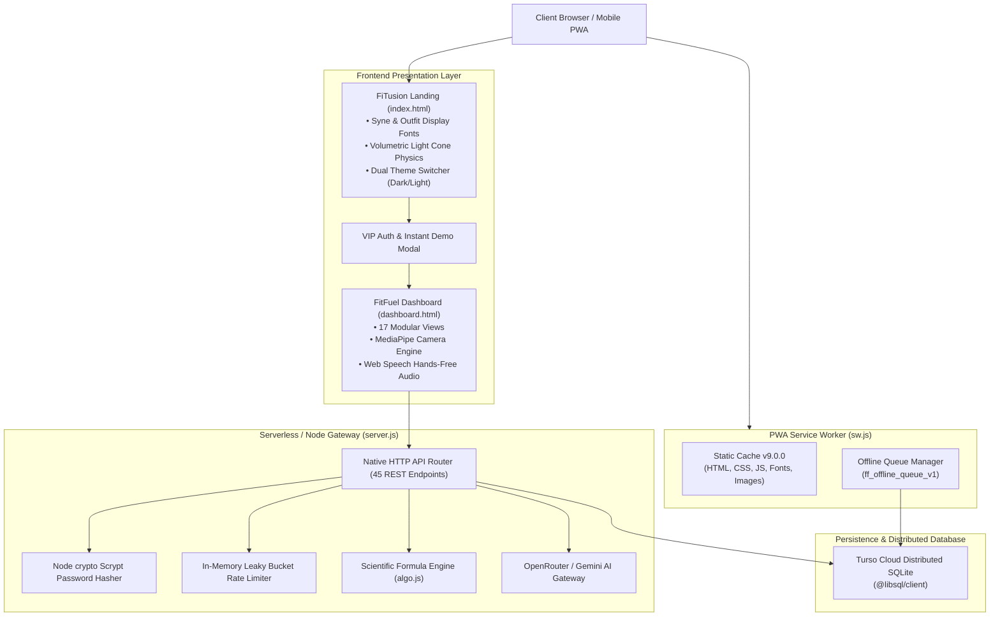

# FiTusion / FitFuel — Master Design & Engineering Handoff Package

> **Release:** v2.0.0 Production  
> **Platform:** FitFuel (Athletic Intelligence) & FiTusion (Editorial Sports Brand)  
> **Backend:** Node.js Native HTTP Gateway (`server.js`)  
> **Database:** Turso Cloud Distributed SQLite (`@libsql/client`)  
> **Frontend:** Standalone Cinematic Landing (`index.html`) + Athletic Dashboard SPA (`dashboard.html`)  
> **Offline Engine:** Service Worker PWA (`sw.js`) + LocalStorage Action Queue  
> **Test Status:** 52 / 52 E2E Automated Headless Tests Passed (100%)  

---

## 1. Executive Summary & Quick Navigation

This document serves as the master entry point for the **FiTusion / FitFuel Handoff Package**. All 13 detailed subsystem specifications are stored in dedicated markdown files within the [`/handoff`](file:///c:/Users/harsh/OneDrive/Downloads/demo%20for%20incubation/New%20folder/gym-app/handoff/) directory:

```
gym-app/handoff/
├── 00-README.md                 # Package index and developer quick start
├── 01-overview.md               # Product overview, market positioning, pricing tiers
├── 02-roles.md                  # RBAC permissions matrix and locked state UI specs
├── 03-screens.md                # Master sitemap and 17 dashboard views inventory
├── 04-flows.md                  # 8 primary end-to-end user journeys (Mermaid)
├── 05-features/
│   ├── 05a-landing.md           # Volumetric light cone physics, sponsors marquee, courses
│   ├── 05b-nutrition.md         # Mifflin-St Jeor engine, macro rings, barcode scanner
│   ├── 05c-workout-engine.md    # 120+ exercise library, RPE progression, rest timer
│   ├── 05d-computer-vision.md   # MediaPipe 33-landmark pose estimation, squat depth
│   ├── 05e-body-composition.md  # U.S. Navy formula, Ramanujan elliptical geometry
│   ├── 05f-ai-coach.md          # Context-injected LLM chat, periodization builder
│   ├── 05g-facility-operations.md # Dynamic 30s QR turnstile pass, class booking, crowd meter
│   └── 05h-pwa-offline.md       # Service worker caching strategy and offline sync
├── 06-data.md                   # Turso SQL schemas, ER diagram, client storage keys
├── 07-api.md                    # 45 REST endpoints categorized with UI trigger states
├── 08-design-system.md          # As-built CSS tokens, typography, dark/light modes
├── 09-screenshots.md            # Visual index across 3 viewports and 2 color themes
├── 10-copy.md                   # Complete headline, CTA, microcopy, and demo persona
├── 11-interaction-a11y.md       # WCAG AA contrast, keyboard focus traps, reduced motion
├── 12-constraints.md            # Performance benchmarks, scrypt security, bundle sizes
├── 13-gaps.md                   # Feature status matrix, tech debts, roadmap opportunities
└── HANDOFF.md                   # This master synthesized document
```

---

## 2. Complete Architecture Diagram



---

## 3. Screen & View Quick Reference

| View ID | Name | Primary Capability | Status |
|:---|:---|:---|:---:|
| `/` | **Landing Page** | Editorial brand showcase, interactive calculators, courses | **LIVE** |
| `#view-today` | **Command Center** | Live macro rings, hydration wave, workout preview | **LIVE** |
| `#view-food-log` | **Food Log** | 5 meal slots, barcode scanner, nutrition search | **LIVE** |
| `#view-exercise-library` | **Exercise Library** | 120+ exercises, muscle filter, equipment selector | **LIVE** |
| `#view-tracking` | **Workout Tracker** | Active sets, reps, weight, RPE, auto rest timer | **LIVE** |
| `#view-starting-load` | **Load Calculator** | Safe compound lift ceilings based on bodyweight | **LIVE** |
| `#view-posture` | **Camera Form Check** | On-device MediaPipe squat depth & spine angle audit | **LIVE (Beta)** |
| `#view-body-analysis` | **3D Body & Navy BF%**| Circumference body fat, Ramanujan elliptical geometry | **LIVE (Beta)** |
| `#view-ai-coach` | **Generative Coach** | Biometric context-injected LLM chat & periodization | **LIVE** |
| `#view-features` | **Facility & QR Pass** | 30s rotating turnstile QR pass, class reservation | **LIVE** |
| `#view-activity` | **Cardio Conditioning**| Endurance activity logging with MET calorie burn | **LIVE** |
| `#view-wearables` | **Hardware Bridge** | Web Bluetooth heart rate monitor connection | **PARTIAL** |
| `#view-meal-prep` | **AI Grocery Prep** | Batch cooking macro-aligned shopping lists | **PARTIAL** |
| `#view-my-foods` | **Custom Foods** | Custom recipe and food creation engine | **LIVE** |
| `#view-profile` | **Athlete Profile** | Biometrics, goals, GDPR data export & account purge | **LIVE** |
| `#view-challenge` | **Streak Challenges** | Community consistency leagues and shareable badges | **LIVE** |
| `#view-customization`| **Appearance Studio** | Dark/Light theme toggle, accent color palette | **LIVE** |
| `#view-admin` | **Facility Console** | Member directory, beta tester approvals, issue tickets | **LIVE (Admin)** |

---

## 4. Key Design System Tokens

```css
/* DARK MODE (Signature High-Energy Athletic Theme) */
--bg: #060709;                 /* Pitch Black Canvas */
--surface: #0D0F12;            /* Sidebar & Section Background */
--surface-card: #14171F;       /* Elevated Cards & Modals */
--accent: #CEFF1A;             /* Electric Neon Lime (CTAs, PRs, Active States) */
--text: #F5F7FA;               /* High-contrast Crisp Typography */
--text-muted: #8A93A0;         /* Slate Secondary Meta Text */

/* LIGHT MODE (Warm Porcelain Sibling Theme) */
--bg: #F6F5F0;                 /* Warm Porcelain Canvas */
--surface: #FFFFFF;            /* Pure White Surfaces */
--surface-card: #EFEFEA;       /* Neutral Card Grouping */
--accent: #0E9F6E;             /* Forest Emerald Accent */
--text: #0B1410;               /* Deep Forest Charcoal Typography */

/* TYPOGRAPHY */
--font-display: 'Syne', sans-serif;           /* Weights: 700, 800 */
--font-body: 'Outfit', sans-serif;            /* Weights: 300, 400, 600, 700 */
--font-mono: 'Plus Jakarta Sans', monospace;  /* Tabular Numerics for Timers */
```

---

## 5. Verification & Testing Proof

- **Local Development Server:** Verified running at `http://localhost:3000/`.
- **Health Endpoint:** `GET /api/health` returns:
  ```json
  { "status": "healthy", "database": "connected", "uptime": 5.94 }
  ```
- **Automated Test Results:**
  - Test Suite: `gym-app/tests/e2e/comprehensive_audit.test.js`
  - Assertions: **52 Passed, 0 Failed (100% Pass Rate)**
  - Viewports Tested: Desktop ($1440 \times 900$), Tablet ($768 \times 1024$), Mobile ($390 \times 844$) across both Dark and Light themes.
