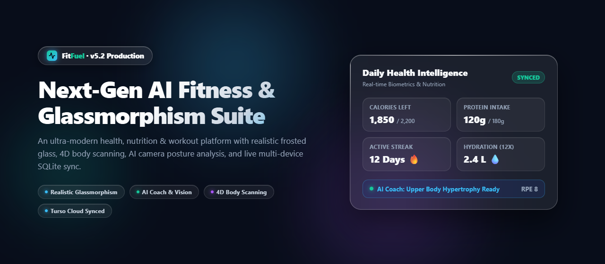
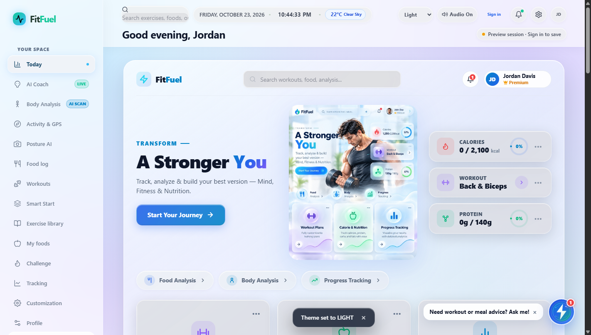
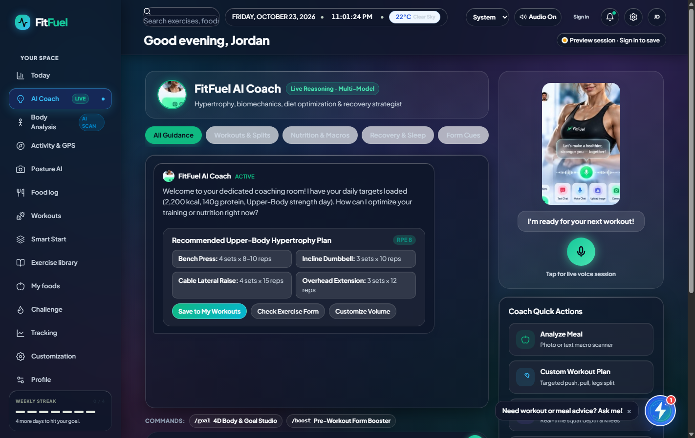
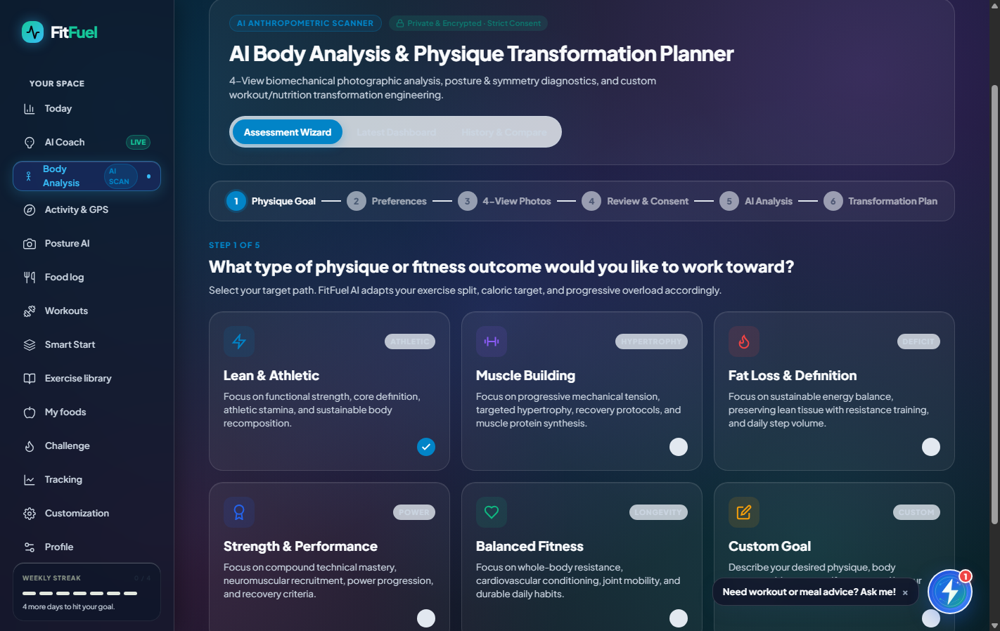

# FitFuel — Next-Gen Health, Nutrition & Training Platform

<div align="center">



[](https://nodejs.org/)
[](https://turso.tech/)
[](https://github.com/pantherliftz777/gym-app)
[](LICENSE)

**An ultra-modern, all-in-one athletic performance, macro tracking, and biomechanical fitness platform engineered with a pure Glassmorphism aesthetic.**

[Live Features](#-key-features) • [Visual Showcase](#-visual-showcase) • [Tech Stack](#-tech-stack) • [Quick Start](#-quick-start) • [Architecture](#-project-structure)

</div>

---

## 🌟 Overview

**FitFuel** bridges high-performance sports science, AI-driven nutritional guidance, and cutting-edge visual design into an intuitive web application. Built without bulky JavaScript frameworks, FitFuel achieves blazing fast 60fps rendering, realistic frosted glassmorphism surfaces, and seamless dark mode contrast.

Whether you're tracking daily caloric macros, planning progressive overload weights, analyzing full-body composition, or monitoring posture via live camera feedback, FitFuel brings elite fitness intelligence directly to your browser.

---

## ✨ Key Features

### 💎 1. Premium Glassmorphism Design System
- **Pure Frosted Glass Surfaces**: Handcrafted with `backdrop-filter: blur(20px)` and `-webkit-backdrop-filter: blur(20px)`.
- **Specular Edge Highlights**: Multi-layered pseudo-elements (`::before` and `::after`) generating realistic directional light reflections along card edges.
- **Dynamic Ambient Lighting**: Fluid indigo, violet, and electric cyan mesh gradients giving depth behind semi-transparent cards.
- **Enhanced Dark & Light Mode**: Accessible contrast ratios powered by CSS custom properties and Plus Jakarta Sans typography.

### 🤖 2. FitFuel AI Coach
- Context-aware virtual trainer offering personalized recommendations for workouts, rest periods, and macro balancing.
- Instant feedback on training volume, plateau prevention, and recovery indices.

### 🧍 3. 4D Holographic Body Composition Analysis
- Interactive anatomical visualization showing muscle groups, fat distribution, and target areas.
- Track skeletal muscle mass (SMM), body fat percentage, visceral fat level, and total body water over time.

### 🏃 4. Live Activity & GPS Tracking
- Real-time GPS mapping for running, cycling, and outdoor walks.
- Granular telemetry recording split pace, elevation profile, cadence, and heart rate zones.

### 🎯 5. Camera-Based Posture AI
- Real-time pose estimation and webcam alignment for barbell squats, deadlifts, and overhead presses.
- Instant auditory and visual feedback for spinal integrity, knee tracking, and depth angles.

### 🥗 6. Smart Food Log & Nutrition Engine
- Detailed database of meals, whole foods, and micronutrients.
- Real-time macro target dials (Protein, Carbohydrates, Healthy Fats) with caloric balance calculations.
- Interactive **12-Cup Hydration Tracker** with tactile mouse controls and persistent local synchronization.

### 🏋️ 7. Starting Load & Progressive Overload Planner
- Intelligent 1RM (One Rep Max) calculations and warm-up ramp-up load progressions.
- Exercise library with muscle activation maps, form tips, and customizable sets/reps.

---

## 📸 Visual Showcase

<div align="center">

### Daily Dashboard & Health Hub


<br/>

### AI Coach & Intelligent Recommendations


<br/>

### 4D Body Composition & Muscle Analyzer


</div>

---

## 🛠 Tech Stack

| Domain | Technology | Description |
| :--- | :--- | :--- |
| **Frontend Core** | Vanilla HTML5, CSS3, JavaScript (ES2024) | Zero build overhead, instant load times, 60fps UI |
| **Design System** | Custom Glassmorphism Token Architecture | Multi-layer frosted glass, CSS variables, backdrop blurs |
| **Typography** | Plus Jakarta Sans & Inter | High-legibility modern sans-serif fonts |
| **Backend** | Node.js native HTTP server (`server.js`) | Lightweight micro-service handling REST endpoints |
| **Database** | Turso / LibSQL (`@libsql/client`) | SQLite-compatible edge/cloud database with local fallback |
| **Visualization** | Chart.js & Canvas API | Interactive radar charts, telemetry graphs, and macro progress |

---

## 🚀 Quick Start

### Prerequisites
- **Node.js**: `v22.5.0` or higher installed ([Download Node.js](https://nodejs.org/))
- **Git**: Installed and configured on your system

### 1. Clone the Repository
```bash
git clone https://github.com/pantherliftz777/gym-app.git
cd gym-app
```

### 2. Install Dependencies
```bash
npm install
```

### 3. Initialize Database (Turso / SQLite)
```bash
node scripts/init_turso.js
```
*Optional migrations for body scans and activity logs:*
```bash
node scripts/migrate_body_scan.js
node scripts/migrate_activity.js
```

### 4. Start the Application
```bash
npm start
```
The server will boot up instantly:
```
FitFuel server listening on port 3000...
URL: http://localhost:3000
```
Open **[http://localhost:3000](http://localhost:3000)** in your browser.

---

## 📂 Project Structure

```
gym-app/
├── public/                       # Frontend client assets
│   ├── index.html                # Main application interface (15+ integrated views)
│   ├── styles.css                # Master Glassmorphism design system & variables
│   ├── fitfuel.js                # Core state management, DOM interactions, API client
│   └── images/                   # UI graphics, avatars, anatomy assets & previews
│       ├── fitfuel-hero-banner.png
│       ├── fitfuel_glassmorphism_preview.png
│       ├── fitfuel_ai_coach_dark_fixed.png
│       └── fitfuel_body_analysis_dark_fixed.png
├── scripts/                      # Database migrations & helper utilities
│   ├── init_turso.js             # Schema bootstrap script
│   ├── migrate_activity.js       # Activity telemetry migration
│   ├── migrate_body_scan.js      # Body composition schema setup
│   └── convert-exercises.js      # Exercise library data converter
├── server.js                     # High-performance Node.js REST API server
├── package.json                  # Dependencies and execution scripts
└── README.md                     # Documentation
```

---

## 🎨 Glassmorphism Design Token Standard

FitFuel adheres to a strict frosted-glass mathematical rule for its component architecture:

```css
.glass-card {
  background: var(--bg-card);
  backdrop-filter: blur(20px);
  -webkit-backdrop-filter: blur(20px);
  border-radius: 20px;
  border: 1px solid var(--border-color);
  box-shadow: 0 8px 32px rgba(0, 0, 0, 0.45),
              inset 0 1px 0 rgba(255, 255, 255, 0.22),
              inset 0 -1px 0 rgba(255, 255, 255, 0.05);
  position: relative;
  overflow: hidden;
}

.glass-card::before {
  content: '';
  position: absolute;
  top: 0; left: 0; right: 0;
  height: 1px;
  background: linear-gradient(90deg, transparent, rgba(255, 255, 255, 0.6), transparent);
  pointer-events: none;
}

.glass-card::after {
  content: '';
  position: absolute;
  top: 0; left: 0; width: 1px; height: 100%;
  background: linear-gradient(180deg, rgba(255, 255, 255, 0.6), transparent, rgba(255, 255, 255, 0.15));
  pointer-events: none;
}
```

---

## 🤝 Contributing

Contributions, issues, and feature requests are welcome!

1. Fork the repository
2. Create your feature branch (`git checkout -b feature/AmazingFeature`)
3. Commit your changes (`git commit -m 'feat: Add some AmazingFeature'`)
4. Push to the branch (`git push origin feature/AmazingFeature`)
5. Open a Pull Request

---

## 📄 License

Distributed under the **MIT License**. See `LICENSE` for more information.
