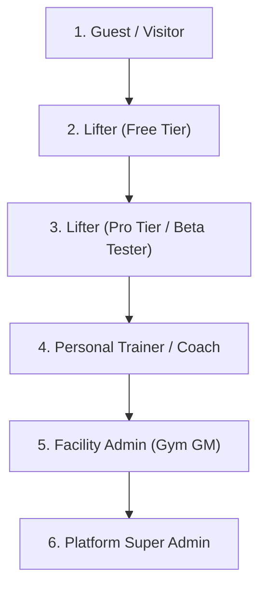

# 02 — User Roles, Permissions & Gating Matrix

> **Source Code & Spec Citations:**  
> - `gym-app/server.js` (Lines 133–152, 1021–1092)  
> - `gym-app/public/shared/betaAccess.js` (Lines 1–95)  
> - `gym-app/public/modules/beta-manager.js` (Lines 1–120)  
> - `gym-app/public/features.js` (Lines 1–85, 300–450)  
> - `gym-app/public/dashboard.html` (Lines 70–95, 745–780)  

---

## 1. Role Hierarchy

The platform operates under a Role-Based Access Control (RBAC) model spanning 6 distinct permission tiers:



---

## 2. Permissions Matrix

| Capability / Screen | Guest (Public) | Lifter (Free) | Lifter (Pro / Beta) | Trainer | Facility Admin | Super Admin | Source File:Line |
|:---|:---:|:---:|:---:|:---:|:---:|:---:|:---|
| **View Landing (`index.html`)** | ✅ LIVE | ✅ LIVE | ✅ LIVE | ✅ LIVE | ✅ LIVE | ✅ LIVE | `index.html:1` |
| **Interactive Calculators** | ✅ LIVE | ✅ LIVE | ✅ LIVE | ✅ LIVE | ✅ LIVE | ✅ LIVE | `app.js:65` |
| **Daily Command (`#view-today`)** | ❌ (Redirects) | ✅ LIVE | ✅ LIVE | ✅ LIVE | ✅ LIVE | ✅ LIVE | `dashboard.html:120` |
| **Log Workouts & Sets** | ❌ | ✅ LIVE | ✅ LIVE | ✅ LIVE | ✅ LIVE | ✅ LIVE | `fitfuel.js:3200` |
| **120+ Exercise Library** | ❌ | ✅ LIVE | ✅ LIVE | ✅ LIVE | ✅ LIVE | ✅ LIVE | `dashboard.html:1240` |
| **Nutrition & Macro Donut** | ❌ | ✅ LIVE | ✅ LIVE | ✅ LIVE | ✅ LIVE | ✅ LIVE | `fitfuel.js:1420` |
| **Barcode Scanner** | ❌ | ✅ LIVE | ✅ LIVE | ✅ LIVE | ✅ LIVE | ✅ LIVE | `barcode-scanner.js:20` |
| **Starting Load Ceiling** | ❌ | ✅ LIVE | ✅ LIVE | ✅ LIVE | ✅ LIVE | ✅ LIVE | `algo.js:98` |
| **AI Coach Interactive Chat** | ❌ | 🔒 Gated / Limited | ✅ LIVE | ✅ LIVE | ✅ LIVE | ✅ LIVE | `server.js:1117` |
| **MediaPipe Posture Checker** | ❌ | 🔒 Beta Locked | ✅ LIVE | ✅ LIVE | ✅ LIVE | ✅ LIVE | `mediapipe-posture.js:15` |
| **3D Body Mesh Analysis** | ❌ | 🔒 Beta Locked | ✅ LIVE | ✅ LIVE | ✅ LIVE | ✅ LIVE | `server.js:858` |
| **Turnstile QR Gate Pass** | ❌ | ✅ LIVE | ✅ LIVE | ✅ LIVE | ✅ LIVE | ✅ LIVE | `features.js:31` |
| **Class Schedule Booking** | ❌ | ✅ LIVE | ✅ LIVE | ✅ LIVE | ✅ LIVE | ✅ LIVE | `features.js:19` |
| **Client Roster Review** | ❌ | ❌ | ❌ | 📋 PLANNED | 📋 PLANNED | ✅ LIVE | `01-overview.md` |
| **Live Floor Occupancy** | ❌ | ✅ LIVE | ✅ LIVE | ✅ LIVE | ✅ LIVE | ✅ LIVE | `features.js:169` |
| **Issue Ticket Submission** | ❌ | ✅ LIVE | ✅ LIVE | ✅ LIVE | ✅ LIVE | ✅ LIVE | `server.js:972` |
| **Admin Console (`#view-admin`)** | ❌ | ❌ | ❌ | ❌ | 🔒 Facility Ops | ✅ LIVE | `server.js:1021`, `fitfuel.js:5100` |
| **User Ban / Delete** | ❌ | ❌ | ❌ | ❌ | ❌ | ✅ LIVE | `server.js:1046` |
| **Beta Application Approval**| ❌ | ❌ | ❌ | ❌ | ❌ | ✅ LIVE | `server.js:514` |

---

## 3. What Locked States Look Like in the UI

When an unauthorized or lower-tier user attempts to access an elevated feature, the application presents standardized, non-destructive UI friction states:

### A. The Beta-Gated Modal (`beta-manager.js`)
- **Trigger:** Clicking `AI Camera Form Checker` (`formCorrectionAi`) or `3D Body Composition Mesh` (`bodyScan3D`) when `is_beta_tester === 0`.
- **UI Treatment:** A frosted glass modal pops up:
  - Header: *"Experimental Beta Feature: [Feature Name]"* with a neon lime badge `BETA ACCESS REQUIRED`.
  - Content: Technical reason explaining that the feature uses intensive local compute (MediaPipe WASM / WebGL).
  - Form: Reason input field + device selector (Desktop, iPhone, Android).
  - CTA Button: `Apply for Beta Access` (`POST /api/beta/apply`).
  - Secondary Action: `Preview in Sandbox Mode` (allows interactive UI demo with simulated data).

### B. The Hardware / Waitlist Card (`features.js`)
- **Trigger:** Clicking `Apple Watch & Whoop Sync` or `AI Grocery & Meal Prep Generator`.
- **UI Treatment:**
  - Status Pill: `COMING SOON` (Dark amber background).
  - Button State: `Join Hardware Waitlist` (replaces launch button).
  - Action: Clicking opens a modal prompting for the athlete's email address and device model, submitting to `POST /api/features/waitlist`.

### C. Admin View Shielding (`dashboard.html` & `fitfuel.js`)
- **Trigger:** Navigating to `#view-admin` without administrative credentials.
- **Client Shield:** In `fitfuel.js:renderAdminView()`, if `!session.is_admin` and `!window.isBetaDemoAdminMode`, the view renders a security lock state:
  > **"Restricted Access — Administrator Privileges Required"**  
  > *"Please sign in with an executive facility account or activate Demo Admin Mode."*
- **Server Shield:** Endpoints under `/api/admin/*` reject non-admin requests with HTTP 403:
  ```json
  { "error": "Unauthorized. Admin role required." }
  ```
