# 03 — Screen Inventory & Master Sitemap

> **Source Code Citations:**  
> - `gym-app/public/index.html` (Lines 1–639)  
> - `gym-app/public/dashboard.html` (Lines 1–120, 1240–6950)  
> - `gym-app/public/fitfuel.js` (`switchView()` router, Lines 1200–5600)  

---

## 1. Master Application Sitemap

```mermaid
graph TD
    Root["Public Landing (index.html)"] --> Auth["Auth & Demo Modal"]
    Auth --> Dashboard["Unified Member Dashboard (dashboard.html)"]
    
    subgraph CoreViews["Core Athlete Daily Views"]
        Dashboard --> V_Today["#view-today (Command Center)"]
        Dashboard --> V_FoodLog["#view-food-log (Macro Diary)"]
        Dashboard --> V_Exercise["#view-exercise-library (120+ Exercises)"]
        Dashboard --> V_Tracking["#view-tracking (Workout Log & PRs)"]
        Dashboard --> V_StartingLoad["#view-starting-load (1RM Calculator)"]
        Dashboard --> V_MyFoods["#view-my-foods (Custom Recipes)"]
        Dashboard --> V_Profile["#view-profile (Biometrics & Settings)"]
        Dashboard --> V_Challenge["#view-challenge (Community Streaks)"]
        Dashboard --> V_Activity["#view-activity (Cardio & Conditioning)"]
    end

    subgraph IntelligenceViews["AI & Computer Vision Intelligence"]
        Dashboard --> V_AICoach["#view-ai-coach (Chat & Plan Gen)"]
        Dashboard --> V_Posture["#view-posture (MediaPipe CV Audit)"]
        Dashboard --> V_BodyAnalysis["#view-body-analysis (3D & Navy BF%)"]
    end

    subgraph FacilityViews["Facility & Studio Operations"]
        Dashboard --> V_Features["#view-features (QR Pass, Class Booking, Crowd)"]
        Dashboard --> V_Wearables["#view-wearables (BLE Heart Rate Bridge)"]
        Dashboard --> V_MealPrep["#view-meal-prep (Batch Grocery AI)"]
        Dashboard --> V_Customization["#view-customization (Themes & Layout)"]
    end

    subgraph EnterpriseViews["Administration & Governance"]
        Dashboard --> V_Admin["#view-admin (KPIs, Users, Beta Toggles)"]
    end
```

---

## 2. Complete Screen & View Inventory

| View Identifier | Display Name | Purpose & Primary Action | Allowed Roles | Key UI Components | Status | Source File:Line |
|:---|:---|:---|:---:|:---|:---:|:---|
| `/` or `/index.html` | **FiTusion Landing Experience** | Editorial marketing conversion page, interactive calculators, brand showcase. | Public / Guest | Volumetric Light Cone hero, Sponsor Marquee, Discover tabs, Course cards, Testimonial carousel, Calculator modal. | **LIVE** | `index.html:1` |
| `#view-today` | **Daily Command Center** | Daily macro adherence rings, hydration counter, today's workout preview, weekly streak heat calendar. | All Members | 4 SVG Macro Rings (Kcal, P, C, F), Quick-add Water wave widget, Training split card, Calorie deficit gauge. | **LIVE** | `dashboard.html:120`, `fitfuel.js:1420` |
| `#view-food-log` | **Nutrition Diary & Food Log** | Categorized meal logging (Breakfast, Lunch, Dinner, Snacks), calorie calculation, barcode scanning. | All Members | Meal section cards, Food search bar with auto-suggest, Barcode scanner canvas button, Daily macro progress bars. | **LIVE** | `dashboard.html:430`, `fitfuel.js:1890` |
| `#view-exercise-library` | **Exercise Library** | Comprehensive 120+ exercise movements with biomechanical instructions. | All Members | Muscle group chip filter, Equipment selector, Search input, Interactive exercise cards with SVG muscle diagrams. | **LIVE** | `dashboard.html:1240`, `fitfuel.js:2410` |
| `#view-tracking` | **Live Workout Tracker** | Active training session logger: sets, reps, weight, RPE, rest countdown. | All Members | Active set input table, RPE selector (1–10), Auto rest timer bell, 1RM PR achievement badge, Social Card generator. | **LIVE** | `dashboard.html:1850`, `fitfuel.js:3120` |
| `#view-starting-load` | **Starting Load Calculator** | Scientific baseline load recommendation for beginner/intermediate compound lifts. | All Members | Compound lift dropdown (Squat, Bench, Deadlift, OHP, Row), Bodyweight slider, Experience pill selector, Load ceiling card. | **LIVE** | `dashboard.html:2450`, `algo.js:98` |
| `#view-posture` | **AI Computer Vision Form Check** | Real-time joint angle camera tracking for squat depth and spinal curvature. | Pro / Beta | Live HTML5 video feed, Canvas skeleton overlay, Knee/Hip angle gauges, Audio rep cadence synthesizer, Form issue alert pill. | **LIVE (Beta)** | `dashboard.html:2790`, `mediapipe-posture.js:15` |
| `#view-body-analysis` | **3D Body & Anthropometrics** | U.S. Navy circumference body fat calculation and Ramanujan elliptical geometry. | Pro / Beta | Tape measurement inputs (Waist, Neck, Hip), 3D body SVG silhouette, WHR/WHtR health risk radar chart, Fat mass vs Lean mass split. | **LIVE (Beta)** | `dashboard.html:3100`, `algo.js:280` |
| `#view-ai-coach` | **Generative AI Coach** | Conversational coach powered by local heuristics + OpenRouter LLM fallback. | Pro / Beta | Chat transcript container, Suggestion prompt chips ("Generate 4-day split", "High protein low carb snack"), Streaming text renderer. | **LIVE** | `dashboard.html:3550`, `server.js:1117` |
| `#view-features` | **Facility Features & QR Pass** | Gym membership amenities: touchless turnstile QR pass, class reservation, crowd meter. | All Members | Dynamic 30s rotating QR code card, Class calendar agenda with booking buttons, Live gym zone traffic meter. | **LIVE** | `dashboard.html:4020`, `features.js:1` |
| `#view-activity` | **Cardio & Conditioning Log** | Endurance activities (Running, Cycling, Rowing, HIIT) with MET calorie burn calculation. | All Members | Activity type selector, Duration input, Distance slider, MET intensity multiplier card, Heart rate zone badge. | **LIVE** | `dashboard.html:4410`, `algo.js:80` |
| `#view-wearables` | **Hardware & Wearable Bridge** | Web Bluetooth connection to external chest straps and smartwatches. | All Members | Web Bluetooth scan trigger, Connected device telemetry card (HR bpm, HRV ms), Live pulse animation. | **PARTIAL** | `dashboard.html:4820`, `fitfuel.js:4600` |
| `#view-meal-prep` | **AI Grocery & Meal Prep** | Batch cooking high-protein meal plans and categorized grocery lists. | Pro / Beta | Days slider (3–7 days), Dietary preference toggles (High Protein, Vegan, Keto), Grocery checklist with aisle sorting. | **PARTIAL** | `dashboard.html:5180`, `fitfuel.js:4850` |
| `#view-my-foods` | **Custom Foods & Recipes** | Personal user-created food items and custom nutritional profiles. | All Members | "Add Custom Food" modal trigger, Recipe macro calculator, Filterable table of saved custom recipes. | **LIVE** | `dashboard.html:5540`, `fitfuel.js:5010` |
| `#view-profile` | **Athlete Profile & Sovereignty** | Biometric personal stats, goal settings, GDPR data export and account erasure. | All Members | Personal metrics form, Target calorie overrides, "Export All Data (JSON)" button, "Permanently Erase Account" trigger. | **LIVE** | `dashboard.html:5850`, `fitfuel.js:5200` |
| `#view-challenge` | **Community Streak Challenges** | Gamified training consistency leagues and badge milestones. | All Members | Leaderboard podium card, Monthly 20-workout challenge progress bar, Shareable achievement badge generator. | **LIVE** | `dashboard.html:6210`, `fitfuel.js:5420` |
| `#view-customization` | **Appearance & Theme Studio** | Theme selection (Dark / Light), accent color customization, sidebar density. | All Members | Palette swatch selector (Neon Lime, Emerald, Cyber Cyan, Crimson), Compact vs Expanded sidebar toggle. | **LIVE** | `dashboard.html:6500`, `fitfuel.js:5550` |
| `#view-admin` | **Facility & Platform Console** | Executive platform KPIs, user management, beta tester enrollments, issue ticketing. | Admin Only | System health gauges, Active user table with ban/delete actions, Beta tester approval queue, Issue ticket status board. | **LIVE (Admin)**| `dashboard.html:6800`, `server.js:1021` |
