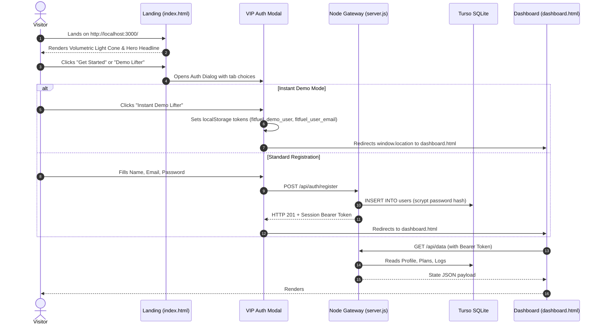
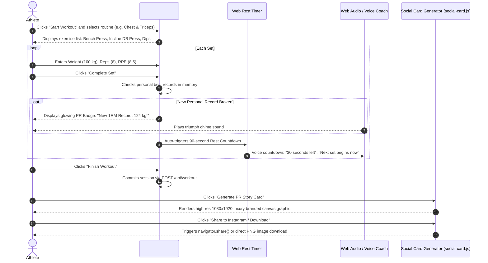
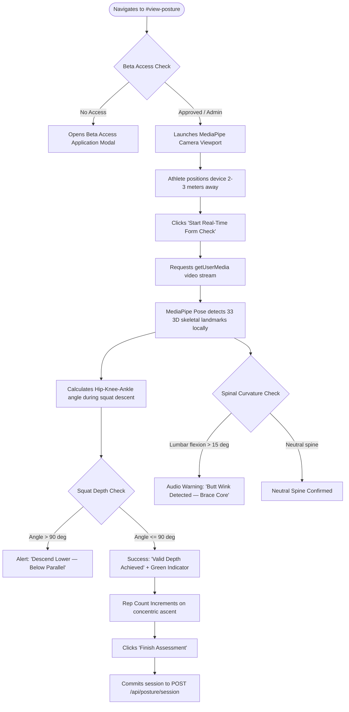
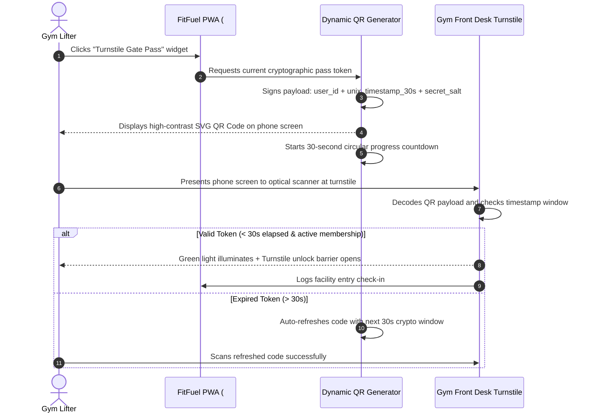

# 04 — Core User Flows & Interaction Journeys

> **Source Code Citations:**  
> - `gym-app/public/index.html` (Lines 1–150)  
> - `gym-app/public/app.js` (Lines 35–180)  
> - `gym-app/public/fitfuel.js` (Lines 1200–5600)  
> - `gym-app/public/modules/social-card.js` (Lines 1–120)  
> - `gym-app/public/modules/mediapipe-posture.js` (Lines 1–110)  
> - `gym-app/public/features.js` (Lines 29–40, 200–350)  
> - `gym-app/server.js` (Lines 682–745, 972–1100)  

---

## Flow 1: First-Time Visitor Onboarding to First Dashboard View



---

## Flow 2: Morning Daily Check-In & Hydration Logging

```mermaid
flowchart TD
    Start([User opens dashboard.html]) --> ViewToday[Navigates to #view-today]
    ViewToday --> LogWeight[Clicks 'Log Weight' button]
    LogWeight --> WeightInput[Enters Morning Bodyweight in kg e.g. 78.4]
    WeightInput --> SaveWeight[Triggers POST /api/weight]
    SaveWeight --> UpdateChart[Weight graph updates with 90-day moving average]
    
    ViewToday --> Hydration[Clicks Hydration Quick-Add button: +250ml / +500ml]
    Hydration --> CalcWater[Client calculates new total: current_ml + delta]
    CalcWater --> SaveWater[Triggers PUT /api/state: { water: { date, ml } }]
    SaveWater --> AnimateWave[Water level wave gauge animates fill percentage]
    
    AnimateWave --> ReviewSplit[Lifter reviews 'Today's Workout: Push A' card]
    ReviewSplit --> End([Ready for training session])
```

---

## Flow 3: Live Workout Execution, PR Break & Social Card Sharing



---

## Flow 4: Nutrition Meal Logging & Barcode Scanning

```mermaid
flowchart TD
    A([User navigates to #view-food-log]) --> B{Log Method Choice}
    B -->|Text Search| C[Types 'Oatmeal' into search bar]
    C --> D[Client queries local USDA / verified nutrition database]
    D --> E[Selects 'Rolled Oats (100g)' from search dropdown]
    
    B -->|Camera Barcode| F[Clicks Barcode Camera Icon]
    F --> G[Opens live video stream on HTML5 canvas]
    G --> H[BarcodeDetector API scans UPC-A / EAN-13 code]
    H --> I[Pulls calorie & macro profile from database]
    
    E --> J[Enters Serving Size e.g. 1.5 servings / 150g]
    I --> J
    J --> K[Selects Meal Slot: Breakfast]
    K --> L[Clicks 'Add to Log']
    L --> M[Appends item to memory log_entries]
    M --> N[Syncs to Turso via PUT /api/state]
    N --> O[Today's 4 Macro Donut Rings instantly redraw with new totals]
```

---

## Flow 5: Conversational AI Coach Consultation & Plan Generation

```mermaid
sequenceDiagram
    autonumber
    actor Athlete
    participant UI as #view-ai-coach
    participant Client as API Client (api.js)
    participant Gateway as Node Server (server.js)
    participant OpenRouter as LLM Inference API

    Athlete->>UI: Enters query: "How do I break through a 100kg bench press plateau?"
    UI-->>Athlete: Displays athlete message bubble + animated thinking dots
    UI->>Client: Calls FF.aiCoach(message, context)
    Client->>Gateway: POST /api/ai-coach with athlete profile (weight, 1RM, current split)
    alt OpenRouter / Gemini API Key Configured
        Gateway->>OpenRouter: Sends enriched system prompt + user question
        OpenRouter-->>Gateway: Streaming response tokens
        Gateway-->>Client: Returns JSON { reply: "..." }
    else Offline Heuristics Fallback
        Gateway->>Gateway: Evaluates local sports biomechanics decision tree
        Gateway-->>Client: Returns verified coaching advice from algo.js knowledge base
    end
    Client-->>UI: Streams reply text into chat box
    opt User requests custom program
        Athlete->>UI: Clicks "Apply Recommended 4-Day Periodization to My Routine"
        UI->>Gateway: POST /api/plans with structured plan payload
        Gateway-->>UI: Plan saved; switches view to #view-tracking
    end
```

---

## Flow 6: MediaPipe Computer Vision Posture & Form Audit



---

## Flow 7: Facility Turnstile Touchless QR Gate Entry



---

## Flow 8: Super Admin Governance & Beta Tester Approval

```mermaid
flowchart TD
    A([Admin logs in via admin@fitfuel.app]) --> B[Navigates to #view-admin]
    B --> C[Checks Platform Telemetry: Total Users, Today's Workouts, Cloud Storage]
    
    B --> D[Scrolls to 'Pending Beta Applications' Section]
    D --> E[GET /api/admin/beta-testers pulls pending lifters]
    E --> F[Admin reviews applicant: device iPhone 15 Pro, reason 'Squat biomechanics']
    
    F --> G{Approval Decision}
    G -->|Approve| H[Clicks 'Approve Access']
    H --> I[POST /api/admin/beta-testers/action: { applicationId, action: 'approve' }]
    I --> J[Turso DB updates beta_applications status = 'approved']
    J --> K[User u.is_beta_tester set to 1]
    
    G -->|Reject| L[Clicks 'Decline']
    L --> M[POST /api/admin/beta-testers/action: { applicationId, action: 'reject' }]
    
    B --> N[Scrolls to Member Registry Table]
    N --> O[Can search users, inspect registration date, or ban spam accounts]
```
