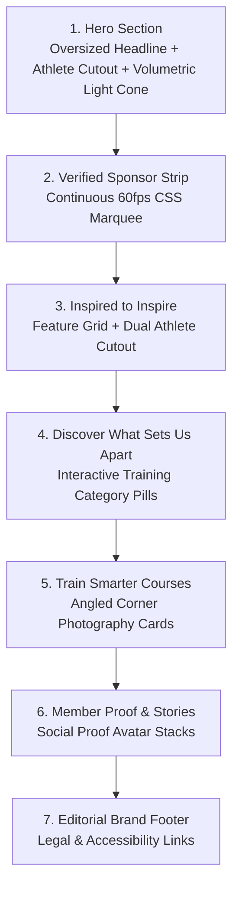

# 05a — Feature Spec: FiTusion Cinematic Landing Experience

> **Status:** LIVE  
> **Source Files & Citations:**  
> - Markup: `gym-app/public/index.html` (Lines 1–639)  
> - Styles: `gym-app/public/styles.css` (Lines 1–1463)  
> - Interactivity: `gym-app/public/app.js` (Lines 1–180)  
> - Controller: `gym-app/public/modules/landing-controller.js` (Lines 1–100)  

---

## 1. Visual Composition & Architecture

The landing page (`index.html`) is designed to mirror high-fashion, editorial sports branding inspired by international athletic design:



---

## 2. Signature Elements & Interaction Mechanics

### A. Volumetric Light Cone & Physics Tracking (`app.js:15–48`, `styles.css:210–260`)
- **Visual Description:** Positioned directly behind the central athlete cutout (`athlete_hero.png`), a semi-transparent radial gradient light cone blooms into view.
- **Physics Behavior:** Tracks mouse pointer coordinates via a high-performance `requestAnimationFrame` lerp loop:
  - Interpolation factor: $\alpha = 0.08$ for smooth, lag-free cinematic dampening.
  - Custom properties dynamically updated on `:root`:
    ```css
    --cone-x: calculated_offset_x;
    --cone-y: calculated_offset_y;
    --tilt-x: calculated_degrees;
    --tilt-y: calculated_degrees;
    ```
- **Light Mode Adaptation:** In Dark Mode, the cone radiates a piercing `#FFFFFF` to `#CEFF1A` white-neon bloom. In Light Mode, it automatically transitions into a warm "morning sunbeam" using pale gold-to-white radial diffusion (`rgba(255, 235, 180, 0.45)`).

### B. Verified Sponsor Marquee (`index.html:120–165`, `styles.css:320–370`)
- **Content:** Exact vector SVG marquees for global athletic apparel brands: Under Armour, Reebok, Adidas, Puma, The North Face, Nike.
- **Animation:** Continuous infinite horizontal translate (`translateX(0)` to `translateX(-50%)`) over a 28s duration.
- **Hover Behavior:** Pauses seamlessly on cursor hover (`animation-play-state: paused`) with interactive opacity transition ($0.45 \to 1.0$).

### C. Category & Program Showcase (`index.html:280–380`, `styles.css:540–620`)
- **Pills:** Cardio Training, Strength Build, Fat Loss, HIIT Workouts.
- **Micro-interactions:** 3D card tilt effect on mousemove, neon green accent border pulse, and inline CTA buttons navigating to the interactive trial sandbox.

### D. Angled Corner Course Cards (`index.html:390–480`, `styles.css:640–740`)
- **Photography:** High-contrast monochrome action photography with custom chamfered polygon clip paths:
  ```css
  clip-path: polygon(0 0, calc(100% - 24px) 0, 100% 24px, 100% 100%, 0 100%);
  ```
- **Accent Bevel:** A signature `#CEFF1A` neon diagonal corner pip that scales on card hover.

---

## 3. Responsive Breakpoints

| Viewport | Layout Changes | CSS Rules |
|:---|:---|:---|
| **Desktop (> 1100px)** | Full dual-column hero layout; athlete cutout centered at 720px height; side floating stat badges (`1.5 Hours`, `20 Poses`, `550 Kcal`, `5 Sets`). | `styles.css:120–280` |
| **Tablet (768px – 1099px)** | Hero headline scales to `4.2rem`; floating badges reposition below athlete; 2-column grid for course cards. | `styles.css:1120–1240` |
| **Mobile (< 767px)** | Single-column stacking; mobile navigation drawer opens via hamburger; athlete cutout scales cleanly without horizontal scroll; touch-friendly 48px tap targets. | `styles.css:1250–1460` |
