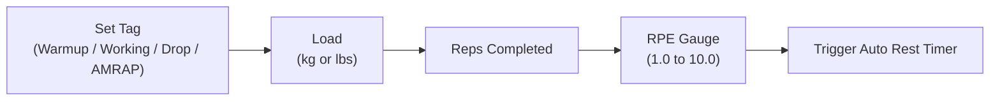

# 05c — Feature Spec: Strength Engine & Exercise Library

> **Status:** LIVE  
> **Source Files & Citations:**  
> - Exercise Library: `gym-app/public/dashboard.html` (`#view-exercise-library`, Lines 1240–1650)  
> - Workout Tracker: `gym-app/public/dashboard.html` (`#view-tracking`, Lines 1850–2250)  
> - Starting Load: `gym-app/public/algo.js` (Lines 95–185)  
> - Progression Engine: `gym-app/public/fitfuel.js` (Lines 2400–3300)  
> - Social PR Cards: `gym-app/public/modules/social-card.js` (Lines 1–120)  

---

## 1. 120+ Curated Exercise Library

The platform includes a comprehensive, offline-cached database of 120+ gym movements categorized across 3 filter dimensions:

| Filter Dimension | Categories Supported |
|:---|:---|
| **Target Muscle Groups** | Chest, Back (Lats/Upper Back), Quads, Hamstrings, Glutes, Shoulders (Anterior/Lateral/Rear), Biceps, Triceps, Calves, Core |
| **Equipment Modality** | Barbell, Dumbbell, Cable, Plate-Loaded Machine, Selectorized Machine, Bodyweight, Resistance Band |
| **Experience Level** | Beginner, Intermediate, Advanced |

Each movement card displays:
- Biomechanical classification (Horizontal Push, Vertical Pull, Hip Hinge, Quad Dominant, Isolated Joint).
- Setup cues and form execution bullet points.
- Animated SVG anatomical muscle highlights indicating primary and secondary synergist muscles.

---

## 2. Active Set Logger & RPE Tracking (`fitfuel.js:3120–3300`)

During an active workout session, lifters record performance per set:

### Rate of Perceived Exertion (RPE) Scale
- **RPE 10:** Absolute limit; could not have performed another rep.
- **RPE 9:** 1 repetition remaining in reserve (1 RIR).
- **RPE 8:** 2 repetitions remaining in reserve (2 RIR).
- **RPE 7:** 3 repetitions in reserve; standard working weight for hyper-accumulation phases.

### Dynamic 1RM & Progressive Overload Formulas (`algo.js:145–170`)
The engine computes estimated One-Rep Max ($\text{e1RM}$) dynamically via the Epley-Brzycki hybrid formula:
$$\text{Estimated 1RM} = \text{Weight} \times \left(1 + \frac{\text{Reps}}{30}\right)$$

When an athlete completes a set that exceeds their recorded historical $\text{e1RM}$, the system:
1. Flags a **New Personal Record (PR)** banner in neon lime.
2. Updates the exercise's baseline record in `profile.prs`.
3. Activates the 1-click **Social Achievement Story Card** export.

---

## 3. Starting Load Ceiling Algorithm (`algo.js:98–140`)

For beginners entering the gym for the first time, FitFuel eliminates injury risk by proposing safe working load ceilings calculated from bodyweight multipliers and movement complexity:

| Movement | Male Untrained | Male Intermediate | Female Untrained | Female Intermediate |
|:---|:---:|:---:|:---:|:---:|
| **Barbell Back Squat** | $0.65 \times \text{BW}$ | $1.25 \times \text{BW}$ | $0.45 \times \text{BW}$ | $0.85 \times \text{BW}$ |
| **Barbell Bench Press** | $0.50 \times \text{BW}$ | $1.00 \times \text{BW}$ | $0.30 \times \text{BW}$ | $0.60 \times \text{BW}$ |
| **Deadlift (Conventional)** | $0.75 \times \text{BW}$ | $1.50 \times \text{BW}$ | $0.55 \times \text{BW}$ | $1.05 \times \text{BW}$ |
| **Overhead Press (OHP)** | $0.35 \times \text{BW}$ | $0.65 \times \text{BW}$ | $0.20 \times \text{BW}$ | $0.40 \times \text{BW}$ |

---

## 4. Integrated Hands-Free Rest Timer & Voice Audio

- **Countdown:** Configurable rest intervals (60s, 90s, 120s, 180s) trigger automatically when a set is logged.
- **Audio synthesis (`voice-coach.js`):** Speaks countdown cues ("Halfway", "15 seconds", "Time to lift") using the browser's `speechSynthesis` engine so lifters don't need to look at screens while resting.
- **Background PWA Notifications:** Sounds audio alerts even if the mobile screen dims or switches apps.
