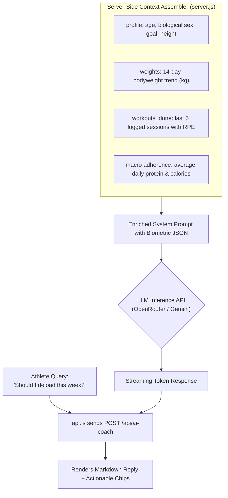

# 05f — Feature Spec: Generative AI Coach

> **Status:** LIVE  
> **Source Files & Citations:**  
> - UI View: `gym-app/public/dashboard.html` (`#view-ai-coach`, Lines 3550–3980)  
> - API Gateway: `gym-app/server.js` (`POST /api/ai-coach`, `POST /api/ai-plan`, Lines 1117–1270)  
> - Frontend Controller: `gym-app/public/api.js` (Lines 1–120)  
> - Heuristic Fallback: `gym-app/public/algo.js` (Lines 80–200)  

---

## 1. Context Injection Architecture

When an athlete chats with the AI Coach, the server dynamically injects their complete biometric and workout history into the system prompt:

---

## 2. Dynamic Periodization & Plan Generator (`POST /api/ai-plan`)

Athletes can prompt the AI Coach to formulate custom periodized training templates based on their available schedule:
- **Available Splits:**
  - 3-Day Full Body (A/B/A cadence)
  - 4-Day Upper / Lower Split
  - 5-Day Push / Pull / Legs / Upper / Lower
  - 6-Day Push / Pull / Legs (PPL $\times 2$)
- **Automated Progression Rules:**
  - Wave loading: 3 weeks of volume accumulation followed by 1 scheduled deload week.
  - Rep ranges assigned dynamically based on goal:
    - Strength focus: $3–5\text{ reps}$ at RPE $8–9$
    - Hypertrophy focus: $8–12\text{ reps}$ at RPE $7–9$
    - Muscular endurance: $15–20\text{ reps}$ at RPE $8$

---

## 3. Heuristic Offline Fallback Engine

If external LLM network connectivity is interrupted, the AI Coach does not fail. Instead, it falls back to a deterministic expert heuristics engine built into `server.js` and `algo.js`:
- Evaluates recent RPE fatigue: if average RPE across the last 3 compound sessions exceeds 9.2, it immediately prescribes a deload protocol (reducing volume by $40\%$ and intensity by $15\%$).
- Answers food replacement queries from a local food substitutions matrix (e.g. *"Replace chicken breast"* $\to$ Egg whites, canned tuna, whey isolate, seitan).
