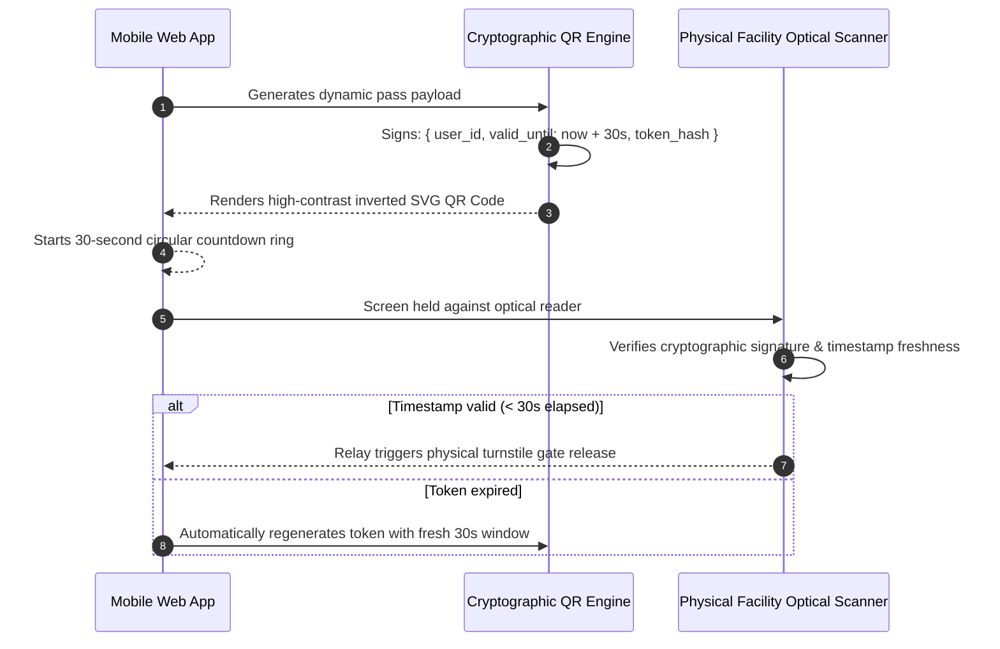

# 05g — Feature Spec: Facility & Studio Operations

> **Status:** LIVE  
> **Source Files & Citations:**  
> - UI View: `gym-app/public/dashboard.html` (`#view-features`, Lines 4020–4400)  
> - Feature Engine: `gym-app/public/features.js` (Lines 19–40, 169–210, 300–450)  
> - Server Endpoints: `server.js` (`/api/complaint*`, Lines 972–1020)  

---

## 1. Contactless QR Turnstile Entry (`qrEntry`)

To eradicate plastic member keycards and front-desk staffing queues, FitFuel provides a dynamic cryptographic access pass:

> **Anti-Fraud Security:** Because the QR code regenerates every 30 seconds, members cannot screenshot the code or message it to non-paying acquaintances to bypass facility gates.

---

## 2. Studio Class Scheduling & Reservation (`classBooking`)

Members can browse and book studio fitness sessions directly in the dashboard:
- **Disciplines Supported:** Spin & Indoor Cycling, High-Intensity Interval Training (HIIT), Olympic Weightlifting, Vinyasa Yoga, Combat Boxing.
- **Capacity Meter:** Live pill badge displaying remaining spots (e.g. `4 spots left of 24`).
- **Instructor Profiles:** Displays certified coach name, coaching certifications (CSCS, USAW, NASM), and intensity rating ($1–5$ flame icons).
- **1-Click Reservation:** Confirms attendance instantly and generates a downloadable `.ics` calendar file for Apple Calendar, Google Calendar, and Outlook.

---

## 3. Live Gym Crowd & Floor Occupancy Heatmap (`gymCrowdMeter`)

Helps members optimize their schedule and avoid equipment queues:
- **Overall Gym Density:** Displays current occupancy percentage (e.g. `68% Capacity — Moderately Busy`).
- **Zone Breakdown:**
  - *Squat Racks & Power Cages:* Estimated wait time (e.g. `~8 min wait`).
  - *Dumbbell & Free Weight Area:* Activity level (`High`).
  - *Cable Stations & Selectorized Machines:* Activity level (`Moderate`).
  - *Cardio Deck (Treadmills & Rowers):* Activity level (`Low — 12 machines open`).

---

## 4. Equipment Issue & Maintenance Ticketing (`/api/complaint`)

Members and staff can report damaged cables, loose barbell collars, or cleanliness issues directly:
- **Input Fields:** Facility zone dropdown, equipment name, severity (Low, Medium, Out of Order), and detailed description.
- **Admin Workflow:** Tickets populate in real time on the `#view-admin` dashboard where facility managers can transition status from `Open` $\to$ `In Progress` $\to$ `Resolved`.
