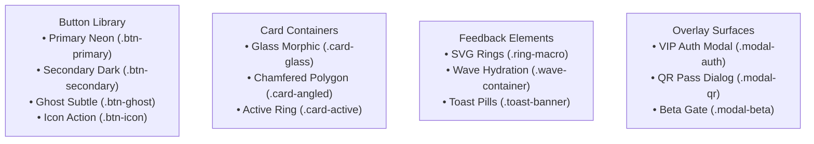

# 08 — Design System & Visual Specification (As-Built)

> **Source Code Citations:**  
> - `gym-app/public/styles.css` (Landing Page Design System, Lines 15–180)  
> - `gym-app/public/dashboard-styles.css` (Dashboard Design System, Lines 1–120, 1100–1250)  

---

## 1. Color System & Theme Palettes

The platform supports two distinct, carefully calibrated visual themes. **Dark Mode** is the primary high-energy athletic identity; **Light Mode** is designed as a warm porcelain editorial counterpart (not an inverted negative).

### A. Dark Mode (Primary High-Performance Theme)

| Token Name | Hex / Value | Semantic Role | Contrast vs BG |
|:---|:---:|:---|:---:|
| `--bg` | `#060709` | Pitch Black Root Canvas | N/A (Base) |
| `--surface` | `#0D0F12` | Sidebar & Primary Section Backdrop | 1.15 : 1 |
| `--surface-card` | `#14171F` | Elevated Cards & Modal Dialogs | 1.35 : 1 |
| `--surface-hover` | `#1A1E27` | Interactive Hover State | 1.55 : 1 |
| `--border` | `rgba(255, 255, 255, 0.08)` | Subtle Component Boundaries | WCAG AA Non-text |
| `--border-strong` | `rgba(255, 255, 255, 0.16)` | Active / Focused Input Borders | 3.2 : 1 |
| `--accent` | `#CEFF1A` | Electric Neon Lime (Primary CTAs, Active Tabs, PRs) | 14.8 : 1 (Exceeds AAA) |
| `--accent-glow` | `rgba(206, 255, 26, 0.35)` | Volumetric Halo & Button Drop Shadows | Decorative |
| `--accent-soft` | `#E2F885` | Sub-labels & Highlight Pills | 12.1 : 1 |
| `--text` | `#F5F7FA` | Primary Headings & Critical Figures | 17.5 : 1 (AAA) |
| `--text-muted` | `#8A93A0` | Secondary Captions & Meta Info | 5.8 : 1 (AA) |

### B. Light Mode (Warm Porcelain Editorial Sibling)

| Token Name | Hex / Value | Semantic Role |
|:---|:---:|:---|
| `--bg` | `#F6F5F0` | Warm Porcelain Canvas |
| `--surface` | `#FFFFFF` | Crisp White Cards & Topbar |
| `--surface-card` | `#EFEFEA` | Secondary Group Containers |
| `--surface-hover` | `#E7E7E0` | Hover Accent Container |
| `--border` | `rgba(10, 20, 15, 0.10)` | Crisp Neutral Separation |
| `--accent` | `#0E9F6E` | Forest Emerald (Replaces Neon Lime) |
| `--text` | `#0B1410` | Deep Forest Charcoal Primary Typography |
| `--text-muted` | `#5B665F` | Slate Sage Muted Typography |

---

## 2. Typography Hierarchy

### A. Font Families
1. **Display Headings:** `'Syne', sans-serif`  
   Geometric, high-fashion, athletic proportions. Weights: `700`, `800`. Letter-spacing: `-0.03em` to `-0.04em`.
2. **Body & UI Elements:** `'Outfit', sans-serif`  
   Clean neo-grotesque readability. Weights: `300`, `400`, `500`, `600`, `700`.
3. **Data & Numbers:** `'Plus Jakarta Sans', sans-serif`  
   Tabular numeric rendering for timer clocks, macro gram counts, and sets.

### B. Type Scale Matrix

| Scale Level | Font Size | Line Height | Tracking | Weight | Target Usage |
|:---|:---:|:---:|:---:|:---:|:---|
| `Display Hero` | `5.5rem` (88px) | `1.02` | `-0.04em` | 800 | Landing page hero headline ("Sculpt Your Body...") |
| `H1 Section` | `3.2rem` (51px) | `1.15` | `-0.03em` | 800 | View headers ("Daily Command", "Nutrition Diary") |
| `H2 Subsection`| `2.0rem` (32px) | `1.25` | `-0.02em` | 700 | Card group headers ("Macro Targets", "Today's Split") |
| `H3 Component` | `1.25rem` (20px) | `1.40` | `-0.01em` | 600 | Exercise names, Modal titles |
| `Body Large` | `1.125rem` (18px) | `1.60` | `0` | 400 | Introductory paragraphs, Coach recommendations |
| `Body Base` | `0.9375rem` (15px) | `1.50` | `0` | 400 | Standard table rows, descriptions |
| `Caption / Meta`| `0.8125rem` (13px) | `1.40` | `+0.02em` | 500 | Timestamps, RPE descriptions, badge tags |

---

## 3. Component Inventory & Interactive States



### A. Button System
- **Primary Accent (`.btn-primary`):** Background `#CEFF1A`, Text `#060709`, font-weight `700`, padding `14px 28px`, border-radius `9999px` (pill), box-shadow `0 8px 24px rgba(206,255,26,0.3)`. On hover: `translateY(-2px)`, shadow intensifies.
- **Secondary Ghost (`.btn-ghost`):** Background `transparent`, border `1px solid rgba(255,255,255,0.12)`, text `#F5F7FA`. On hover: border `#CEFF1A`, background `rgba(206,255,26,0.06)`.
- **Demo Lifter Trigger (`.demo-lifter-trigger`):** Signature outline pill in navbar with neon border pulse.

### B. Card Components
- **Standard Card:** Background `--surface-card`, border `1px solid --border`, border-radius `16px`, padding `24px`.
- **Angled Athletic Card:** Polished 24px chamfered top-right corner with lime green accent beveled notch.

---

## 4. Animation & Motion Design Tokens

```css
:root {
  --ease-spring: cubic-bezier(0.16, 1, 0.3, 1);
  --ease-smooth: cubic-bezier(0.4, 0, 0.2, 1);
  --duration-fast: 150ms;
  --duration-normal: 300ms;
  --duration-slow: 600ms;
}
```

- **Volumetric Bloom:** `@keyframes coneBloom { from { opacity: 0; transform: scale(0.85); } to { opacity: 1; transform: scale(1); } }`
- **Marquee Continuous Translate:** 28 seconds linear infinite translate.
- **Pulsing Neon Glow:** 2.4-second sinusoidal opacity loop (`0.25` to `0.55`) on active workout record badges.
- **Accessibility:** All animations wrap inside `@media (prefers-reduced-motion: reduce)` which forces durations to `0.001ms` and disables transform loops.
